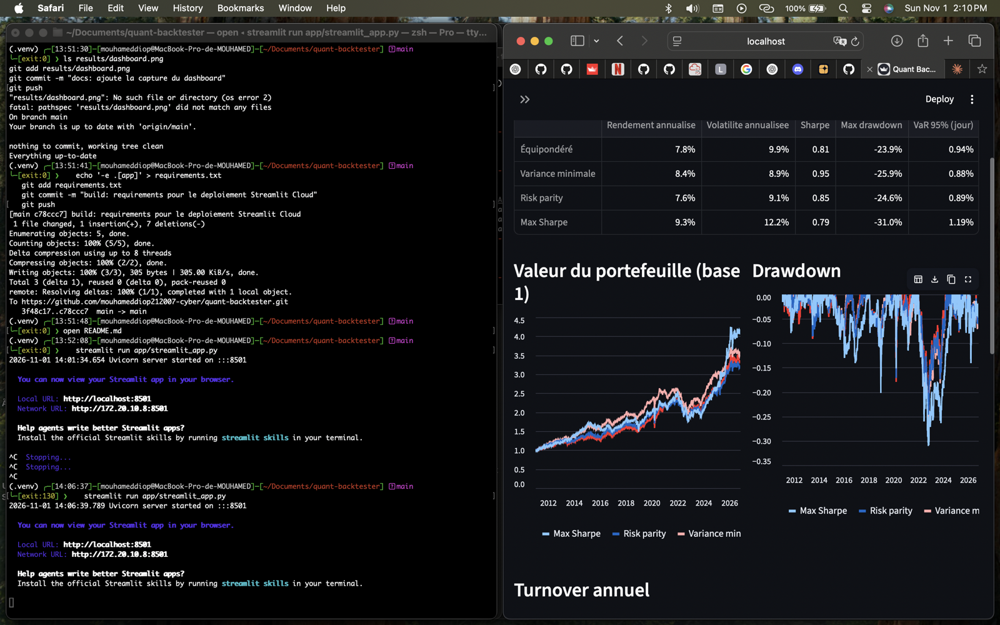
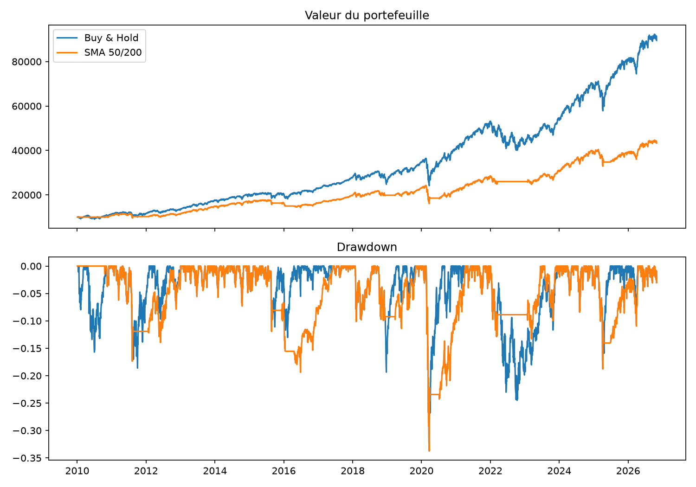
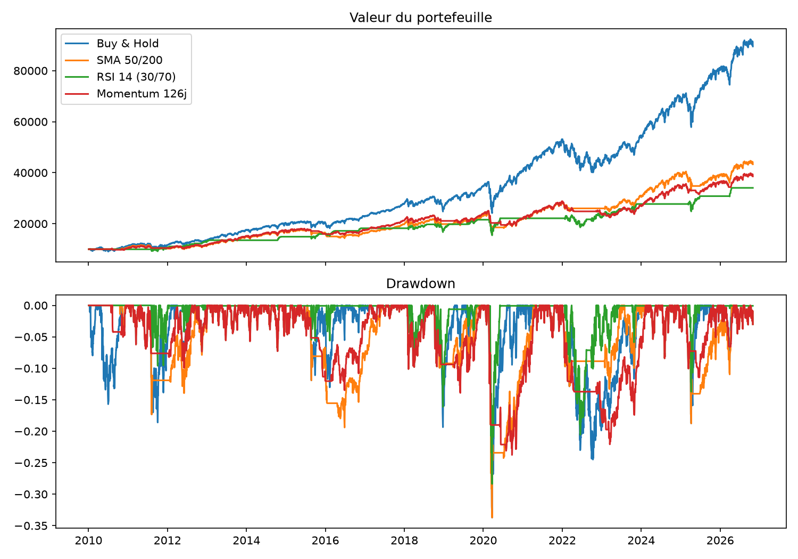
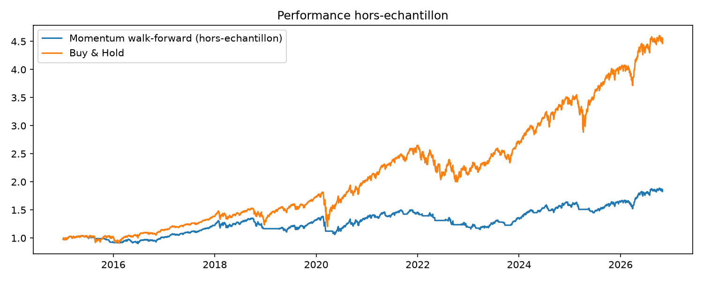

# quant-backtester

Framework Python de backtesting de strategies de trading, concu pour apprendre
la finance de marche et le genie logiciel en parallele. Evolution prevue vers
l'optimisation de portefeuille (Markowitz, VaR/CVaR, Risk Parity).



## Lancer le dashboard
```bash
pip install -e ".[dev]"
streamlit run app/streamlit_app.py
```


## Fonctionnalites actuelles
- Chargement de donnees (yfinance) avec cache local
- Metriques : rendement annualise, volatilite, Sharpe, drawdown maximum
- Classe `Strategy` extensible (Buy & Hold, croisement de moyennes mobiles)
- Moteur de backtest avec **frais de transaction, slippage et execution a J+1**
  (pas de look-ahead bias)

## Résultats (SPY, 2010 à aujourd'hui, frais 5 bps + slippage 2 bps)



| | Rendement annualisé | Volatilité | Sharpe | Max drawdown |
|---|---|---|---|---|
| Buy & Hold | 13,9 % | 17,0 % | 0,85 | -33,7 % |
| SMA 50/200 | 9,1 % | 13,9 % | 0,70 | -33,7 % |

La stratégie SMA réduit la volatilité mais sous-performe le Buy & Hold sur cette période haussière, et elle ne protège pas du krach de mars 2020, trop rapide pour des moyennes mobiles de cette longueur.

## Comparaison de stratégies (SPY, 2010 à aujourd'hui)



| Stratégie | Rendement | Volatilité | Sharpe | Max drawdown |
|---|---|---|---|---|
| Buy & Hold | 13,9 % | 17,0 % | 0,85 | -33,7 % |
| SMA 50/200 | 9,1 % | 13,9 % | 0,70 | -33,7 % |
| RSI 14 (30/70) | 7,6 % | 13,0 % | 0,63 | -28,4 % |
| Momentum 126j | 8,4 % | 11,6 % | 0,75 | -23,8 % |

**Lecture** : aucune stratégie ne bat le Buy & Hold en rendement ajusté du risque sur cette période haussière. Le momentum offre le meilleur compromis : drawdown réduit de 10 points pour environ 5 points de rendement en moins.

**Limites** : le cash ne rapporte rien dans cette version, un seul actif et une seule période sont testés, les résultats passés ne préjugent pas des résultats futurs.


## Installation
```bash
git clone <ton-repo> && cd quant-backtester
python -m venv .venv && source .venv/bin/activate
pip install -e ".[dev]"
pytest
python examples/run_sma.py
```

## Utilisation
```python
from quant_backtester.data import load_prices
from quant_backtester.backtest import run_backtest
from quant_backtester.strategies import SMACrossover
from quant_backtester.metrics import summary

prices = load_prices("SPY", start="2010-01-01")
res = run_backtest(prices, SMACrossover(50, 200))
print(summary(res.returns))
```

## Creer sa propre strategie
Herite de `Strategy` et implemente `generate_signals` (position cible 0 ou 1
calculee avec les informations disponibles a la cloture du jour).

## Limites et biais (a completer avec tes resultats)
- Surapprentissage : tester beaucoup de parametres sur les memes donnees
- Biais du survivant : les tickers actuels ont "survecu"
- Frais et slippage simplifies
- Resultats passes != resultats futurs

## Validation hors-échantillon (walk-forward)



Optimisation de la fenêtre du momentum (20 à 250 jours) sur 5 ans glissants, test sur l'année suivante (12 folds, 2015 à 2026).

| | Rendement | Volatilité | Sharpe | Max drawdown |
|---|---|---|---|---|
| Momentum walk-forward | 5,3 % | 12,0 % | 0,49 | -23,4 % |
| Buy & Hold | 13,5 % | 17,5 % | 0,81 | -33,7 % |

**Lecture** : le momentum réduit le drawdown de 10 points mais ne bat pas le Buy & Hold en rendement ajusté du risque. Le paramètre optimal change à chaque fold (de 20 à 180 jours), ce qui indique qu'il n'y a pas de fenêtre stable à exploiter. Optimiser sur le passé n'a pas produit de gain hors-échantillon.

**Limites** : un seul actif, 12 folds d'une année (faible puissance statistique), le dernier fold est partiel.


## Feuille de route
- [x] Phase 1 : données et métriques
- [x] Phase 2 : moteur de backtest, stratégies SMA, RSI, momentum
- [x] Phase 3 : grid search et validation walk-forward
- [x] Phase 4 : optimisation de portefeuille (Markowitz, Risk Parity, VaR/CVaR)
- [x] Phase 5 : dashboard Streamlit
- [ ] Pricer d'options (Black-Scholes, arbre binomial, Monte Carlo)
- [ ] Stress tests (2008, 2020, 2022)